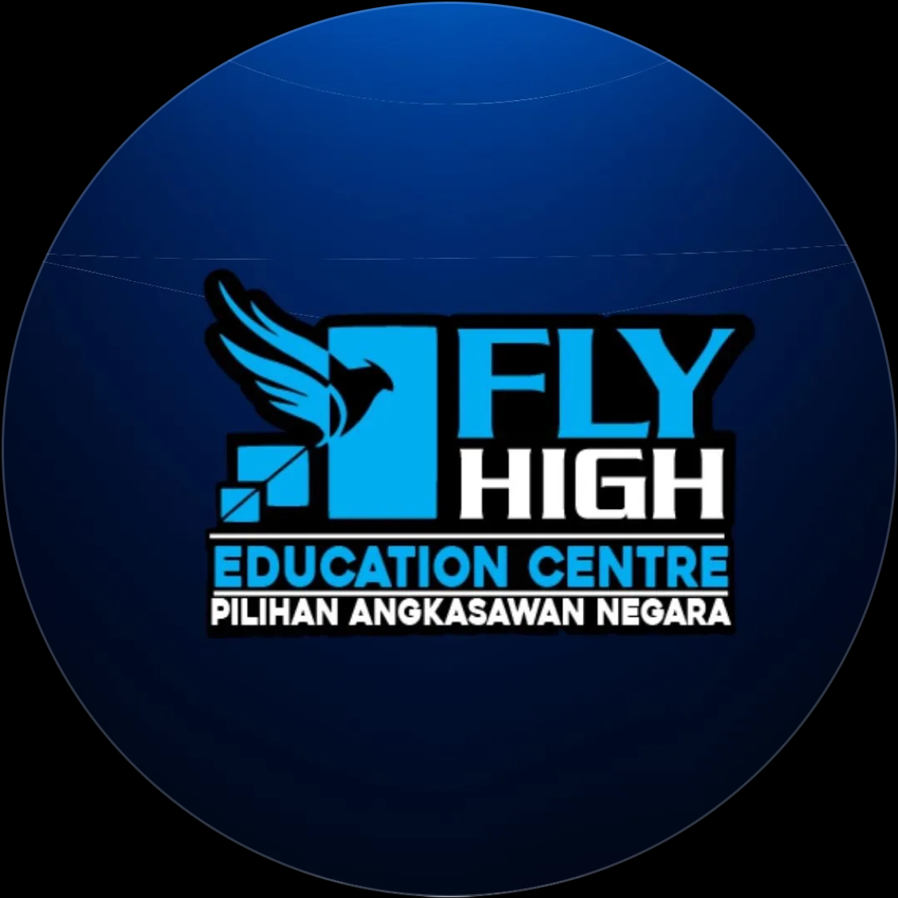

# Storyboard — Last Minute UKKM (FlyHigh Education Centre)



> Video promosi menegak untuk TikTok, Reels dan Shorts, bagi kelas **Last Minute UKKM** (Ujian Khas Kemasukan MRSM) secara online di Zoom.
> Poster rujukan: [`poster-last-minute-ukkm.png`](poster-last-minute-ukkm.png)

## Maklumat produk (dari poster)

| Perkara | Butiran |
|---|---|
| Produk | **Last Minute UKKM** — kelas intensif online (Zoom) |
| Tarikh | 16–19 November 2026 (Isnin–Khamis), 4 malam |
| Jadual setiap malam | **Sains** (Cikgu Shukry) 6.00–7.00 pm • **Keperibadian** (Sir Koala) 8.00–9.00 pm • **Matematik** (GB Shahril) 9.35–10.35 pm |
| Harga | **RM60 / hari** • **Full Pakej RM199** (jimat RM41 berbanding 4 × RM60) |
| Sasaran | Ibu bapa murid Tahun 6 yang akan duduk UKKM |

> ⚠️ **Hari ni 17 Nov — kelas dah mula semalam (16 Nov).** Video ni perlu keluar **secepat mungkin** dan skrip disesuaikan ikut hari ia diposting. Lihat [Versi ikut hari posting](#versi-ikut-hari-posting).

## Spesifikasi video

| Perkara | Butiran |
|---|---|
| Tempoh | ±45 saat |
| Format | Menegak 9:16 — 1080×1920, export CRF 18 |
| Audio | Voiceover MP3 100%; ambient footage 20%; audio talking shot tak diguna |
| Shot | **TS** = talking shot (host), **PS** = product shot (poster, rakaman Zoom, cikgu, grafik) |

## Brand kit

| Peranan | Warna | Guna untuk |
|---|---|---|
| Biru FlyHigh | `#0254CF` | Latar utama (macam poster) |
| Biru langit | `#00AEF0` | Highlight, ikon, garisan |
| Kuning | `#FDE305` | Tajuk "UKKM", label tarikh, kad jadual |
| Merah | `#E31B23` *(anggaran)* | Kotak harga RM60 / RM199, urgency ("TINGGAL 3 MALAM") |
| Putih / Hitam | `#FFFFFF` / `#000000` | Teks, outline tebal gaya sticker |

- **Logo:** `FlyHigh/brand/flyhigh-logo.png`. Letak di kiri bawah (macam poster) dan di end card.
- **Fon:** sans-serif tebal, italik untuk tajuk (macam "LAST MINUTE UKKM" pada poster), contohnya *Montserrat Black Italic*.
- **Tagline:** *"Pilihan Angkasawan Negara"*.

## Susun atur skrin

```
┌──────────────────────────┐
│ [ZOOM ONLINE] LAST MINUTE│  ← jalur tajuk kuning/putih atas biru
│ UKKM          [logo FH]  │
├──────────────────────────┤
│                          │
│  VISUAL TENGAH           │  ← poster / rakaman kelas Zoom /
│  (PS)                    │     kad jadual / kad cikgu
│                    ┌────┐│
├────────────────────│ TS ││  ← host kanan bawah
│ kapsyen + kotak    │host││
│ harga merah        └────┘│
└──────────────────────────┘
```

## Babak demi babak

| # | Masa | Shot | Visual | Voiceover (draf skrip) | Teks atas skrin | Nota edit |
|---|---|---|---|---|---|---|
| 1 | 0:00–0:03 | TS | Close-up host, muka serius | "Anak nak duduk UKKM tapi rasa belum ready?" | **UKKM DAH DEKAT!** | Hook. Zoom-in perlahan |
| 2 | 0:03–0:07 | TS | Medium shot | "Jangan panik. FlyHigh ada kelas **Last Minute UKKM**." | LAST MINUTE UKKM | Cutaway ke logo sekejap pada "FlyHigh" |
| 3 | 0:07–0:11 | PS | Tajuk poster masuk (slide dari kiri, gaya speed-line) + badge **ZOOM ONLINE** | "Online, dari rumah je, melalui Zoom." | 💻 ZOOM ONLINE | |
| 4 | 0:11–0:18 | **PS** | Kad jadual: 4 tarikh muncul satu per satu (16, 17, 18, 19 Nov) | "**Ni jadual dia** — empat malam, 16 sampai 19 November." | 16–19 NOV 2026 | **MATCH CUT** tepat pada perkataan "ni". Tarikh yang dah lepas dipangkah |
| 5 | 0:18–0:22 | PS | Kad subjek: **Sains** + foto Cikgu Shukry | "Satu malam tiga subjek. Sains dengan Cikgu Shukry," | SAINS • 6.00–7.00 PM | Pop-in kad, bunyi "whoosh" |
| 6 | 0:22–0:25 | PS | Kad subjek: **Keperibadian** + foto Sir Koala | "Keperibadian dengan Sir Koala," | KEPERIBADIAN • 8.00–9.00 PM | |
| 7 | 0:25–0:29 | PS | Kad subjek: **Matematik** + foto GB Shahril | "dan Matematik dengan GB Shahril." | MATEMATIK • 9.35–10.35 PM | |
| 8 | 0:29–0:33 | PS | Rakaman kelas Zoom sebenar (grid murid / cikgu mengajar) | "Fokus tips dan teknik jawab saat-saat akhir." | — | Ambient 20%. Kaburkan muka/nama murid |
| 9 | 0:33–0:39 | TS + PS | Host + kotak harga merah muncul | "RM60 je sehari, atau ambil **full pakej RM199**." | **RM60/hari • FULL PAKEJ RM199** | Kotak harga goyang sikit (shake) |
| 10 | 0:39–0:43 | TS | Close-up host, tunjuk ke bawah | "Tempat terhad — daftar sekarang, link kat bawah!" | 👇 DAFTAR SEKARANG | CTA. Panah animasi ke link / bakul |
| 11 | 0:43–0:45 | PS | End card: logo FlyHigh atas biru `#0254CF` | "FlyHigh Education Centre — pilihan angkasawan negara." | PILIHAN ANGKASAWAN NEGARA | Fade out muzik |

> Timing di atas anggaran. Bila MP3 voiceover di-upload, saya akan transcribe dan selaraskan setiap babak ikut masa ayat sebenar.
> Match cut asal dalam README ialah pada "ni sumbangan dia". Untuk produk ni saya guna "**ni jadual dia**". Tukar balik kalau nak kekalkan ayat asal.

## Versi ikut hari posting

Kelas dah bermula, jadi babak 4, 9 dan 10 perlu ikut hari video diposting:

| Hari posting | Babak 4 (VO) | Babak 9–10 (VO) | Teks urgency |
|---|---|---|---|
| **17 Nov (Selasa)** | "Malam ni, esok dan lusa — tinggal **3 malam** lagi." | "Join malam ni, RM60 je. `[Full pakej masih RM199 / harga baki hari?]`" | 🔥 TINGGAL 3 MALAM |
| **18 Nov (Rabu)** | "Tinggal **2 malam** terakhir — malam ni dan esok." | "RM60 semalam, daftar sebelum 6 petang." | ⏰ 2 MALAM TERAKHIR |
| **19 Nov (Khamis)** | "**Malam terakhir** — jangan terlepas." | "RM60 je untuk malam ni. Last call!" | 🚨 MALAM TERAKHIR |

## Senarai shot diperlukan

**Talking shot (TS)**
- [ ] Close-up host, pandang kamera (hook + CTA)
- [ ] Medium shot host

**Product shot (PS)**
- [ ] Fail poster asal (resolusi tinggi) atau elemen poster berasingan (tajuk, kad jadual, kotak harga)
- [ ] Foto Cikgu Shukry, Sir Koala, GB Shahril
- [ ] Rakaman skrin kelas Zoom malam 16 Nov (dapatkan izin, kaburkan muka murid)
- [ ] Logo FlyHigh PNG lutsinar
- [ ] Link pendaftaran / WhatsApp untuk CTA

## Perlu disahkan sebelum edit

1. Harga full pakej selepas kelas bermula: masih RM199 atau ikut baki hari?
2. Link atau nombor pendaftaran untuk CTA
3. Logo MRSM/MARA pada poster: pastikan FlyHigh dibenarkan guna logo tu, atau buang dari video supaya tak nampak macam program rasmi MRSM
4. Kebenaran guna rakaman kelas dan muka murid
